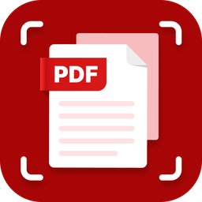
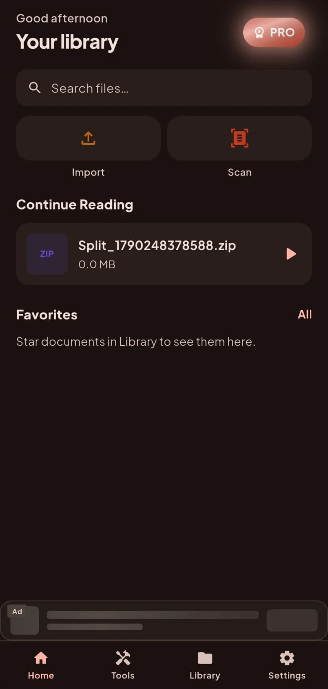
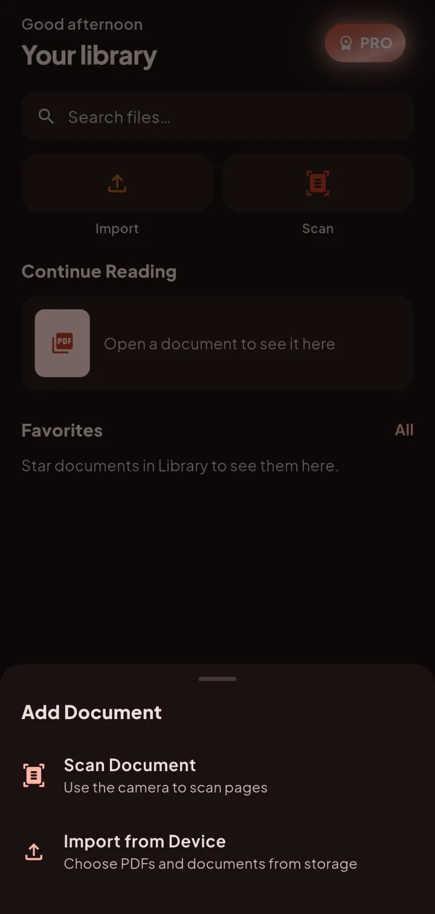
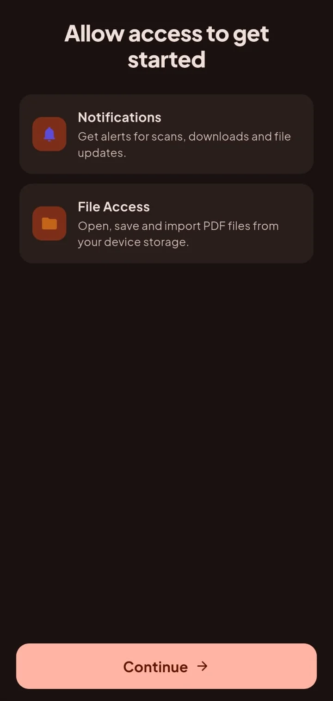
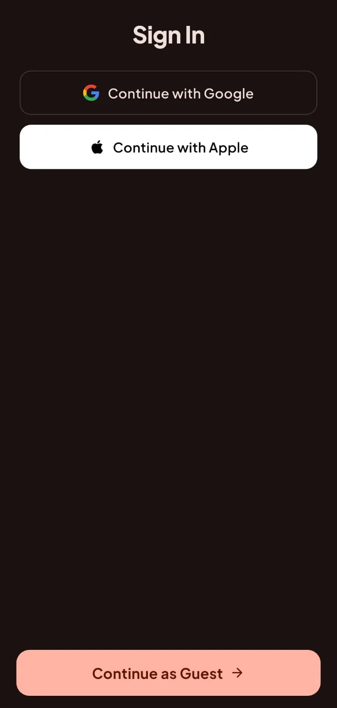
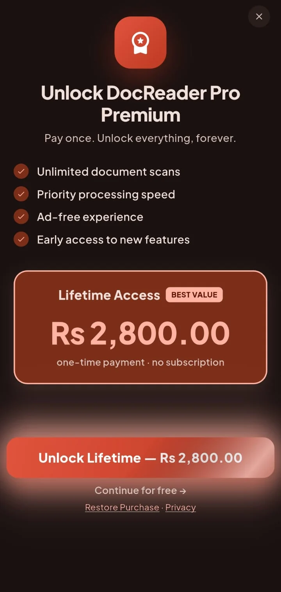
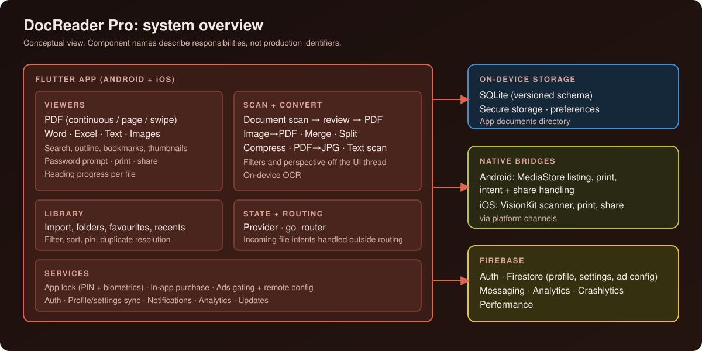
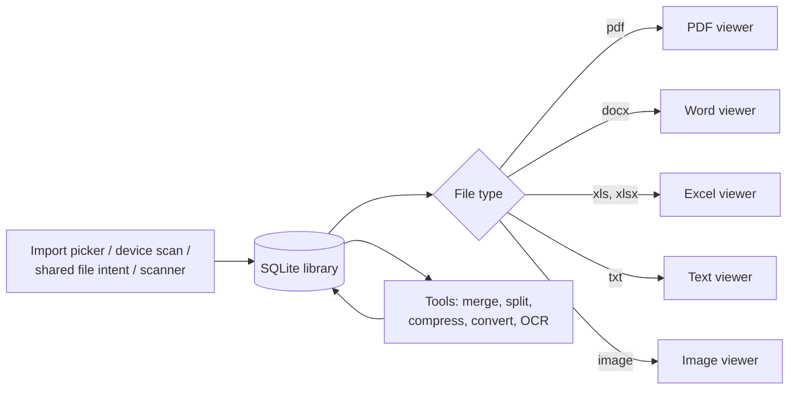

# Doc Reader

**A mobile document reader, scanner and PDF toolbox: open PDF, Word and Excel files, scan paper to PDF with on-device OCR, and merge, split, compress and convert, all backed by a local SQLite library.**

*Published as **DocReader Pro**.*

**Android · iOS** 
Flutter · Dart · SQLite · Firebase · ML Kit · Native Kotlin and Swift bridges

<table>
  <tr>
    <td></td>
    <td></td>
  </tr>
</table>
Real screenshots from the Android app.

---

## Live App

  

## Product at a Glance

| | |
|---|---|
| **What it is** | Document viewer, scanner and PDF toolbox in one app |
| **Platforms** | Android and iOS (Flutter) |
| **Formats** | PDF, Word (.docx), Excel (.xls/.xlsx), text and images; opens files shared from other apps |
| **Scan** | Native document scanners (ML Kit on Android, VisionKit on iOS), crop and filter review, on-device OCR |
| **Tools** | Scan to PDF, image to PDF, merge, split, compress, PDF to JPG, text scan |
| **Storage** | SQLite library with folders, favourites, recents, bookmarks and reading progress |
| **Security** | App lock with PIN and biometrics; secure PIN storage |
| **Monetisation** | One-time Pro unlock, rewarded per-tool unlocks, ads behind remote fail-closed config |
| **Code size** | About 75k lines of Dart, plus Kotlin and Swift native bridges |
| **Languages** | 9 UI languages, including Arabic and Urdu |

## Live Product Showcase

<table>
  <tr>
    <td align="center"> <b>Permissions</b> Explains notifications and file access up front</td>
    <td align="center"> <b>Sign-in or guest</b> Google, Apple, or continue as guest</td>
    <td align="center"> <b>Pro unlock</b> One-time payment, restore purchase</td>
  </tr>
</table>

## Key Features

- **PDF viewer.** Continuous scrolling, single page or horizontal swipe; fit width or fit page; manual zoom that is not overridden by later layout changes; thumbnails and outline panels; full-text search with highlighted hits; bookmarks; reading progress per document; password-protected PDFs; print and share.
- **Office and text files.** Word documents in an in-app viewer, Excel workbooks in a grid viewer with sheet selector, plain text and images. PowerPoint is intentionally not rendered in-app.
- **Open from anywhere.** Registers for PDF, Word and Excel open/share intents on Android, including `content://` URIs.
- **Library.** Import with duplicate resolution, folders, favourites, recents, type filters (PDF, Word, images, scanned), sort by name, date, size or last opened, pinning, multi-select, and a "Continue reading" shelf.
- **Device documents.** Lists PDFs, Office files and images already on the device through MediaStore, without importing them first.
- **Scan.** Native scanners, modes for document, business card and ID/photo, review with crop and filters (original, auto, colour, grayscale, black and white).
- **Convert and edit.** Image to PDF, merge, split, compress at three quality levels, PDF to JPG, and text extraction with on-device OCR.
- **App lock.** PIN stored in secure storage, optional biometric unlock.
- **Accounts.** Google and Apple sign-in, or guest. Profile and settings merge between Firestore and the local database.

## Engineering Highlights

### Imported files "disappear" after an iOS reinstall
- **Problem:** library rows stored absolute paths inside the app's documents directory. On iOS that container path changes on reinstall, so every imported file looked missing and sharing, exporting and viewing failed silently.
- **Approach:** paths are rebased onto the current sandbox at read time, keeping the part after the container root. Android paths are stable, so it is a no-op there. The helper is unit tested.
- **Outcome:** previously imported documents resolve correctly after the container moves.

### PDF search highlights that line up with the text
- **Problem:** search hits come back as baseline-anchored rectangles, so naive boxes cut through glyphs, and case-insensitive search needs to know which casings actually occur.
- **Approach:** text is extracted lazily on a background engine, per-page text is only fetched for pages that produce a hit, and hit rectangles are expanded using typographic ascent/descent ratios to cover the glyphs. Dedicated unit tests cover highlight alignment, word spans and the search service.
- **Outcome:** highlights sit on the matched words rather than beside them.

### Crash-proof printing
- **Problem:** Android's print spooler can crash the whole process when given a malformed PDF, instead of raising a catchable error.
- **Approach:** the file is validated first (it must open as a PDF and start with the PDF header) before it reaches the native print channel, and synchronous native failures are caught.
- **Outcome:** a bad file produces an error message, not a process crash.

### Heavy image work stays off the UI thread
- **Problem:** perspective correction and filters on scanned pages are expensive.
- **Approach:** page processing runs in an isolate via `compute`, and enhanced previews are cached without touching the original image.
- **Outcome:** the review screen stays interactive while pages are processed.

More: [docs/ENGINEERING_CHALLENGES.md](docs/ENGINEERING_CHALLENGES.md).

## Architecture

  

Details: [docs/ARCHITECTURE.md](docs/ARCHITECTURE.md).

## Technology Stack

| Layer | Technology |
|---|---|
| App | Flutter / Dart 3, `provider`, `go_router` |
| PDF | `pdfrx` (PDFium) for rendering and thumbnails, `pdf` and `pdf_manipulator` for building and processing |
| Office | Vendored Word viewer package, `excel_plus` and `pluto_grid` for spreadsheets |
| Scan and OCR | Google ML Kit document scanner and text recognition, Apple VisionKit, `image` for enhancement |
| Storage | `sqflite` (schema version 9), `flutter_secure_storage`, `shared_preferences` |
| Security | `local_auth` biometrics, secure PIN storage |
| Firebase | Auth, Firestore, Messaging, Analytics, Crashlytics, Performance |
| Billing and ads | `in_app_purchase`, Google Mobile Ads with remote per-placement config |
| Native | Kotlin (document listing, print, intents), Swift (scanner, print, share) |

## Documentation

| Read | For |
|---|---|
| [Technical case study](docs/TECHNICAL_CASE_STUDY.md) | End-to-end write-up |
| [Architecture](docs/ARCHITECTURE.md) | Layers, flows and diagrams |
| [Engineering challenges](docs/ENGINEERING_CHALLENGES.md) | Problem, approach, trade-offs, outcome |
| [Product overview](docs/PRODUCT_OVERVIEW.md) | Features, screens and flows |
| [Privacy and source](docs/PRIVACY_AND_SOURCE.md) | What is and is not published |

## Source Code

This repository is a portfolio showcase for a production application. Production source code is maintained privately. See [RIGHTS.md](RIGHTS.md) for usage terms.
