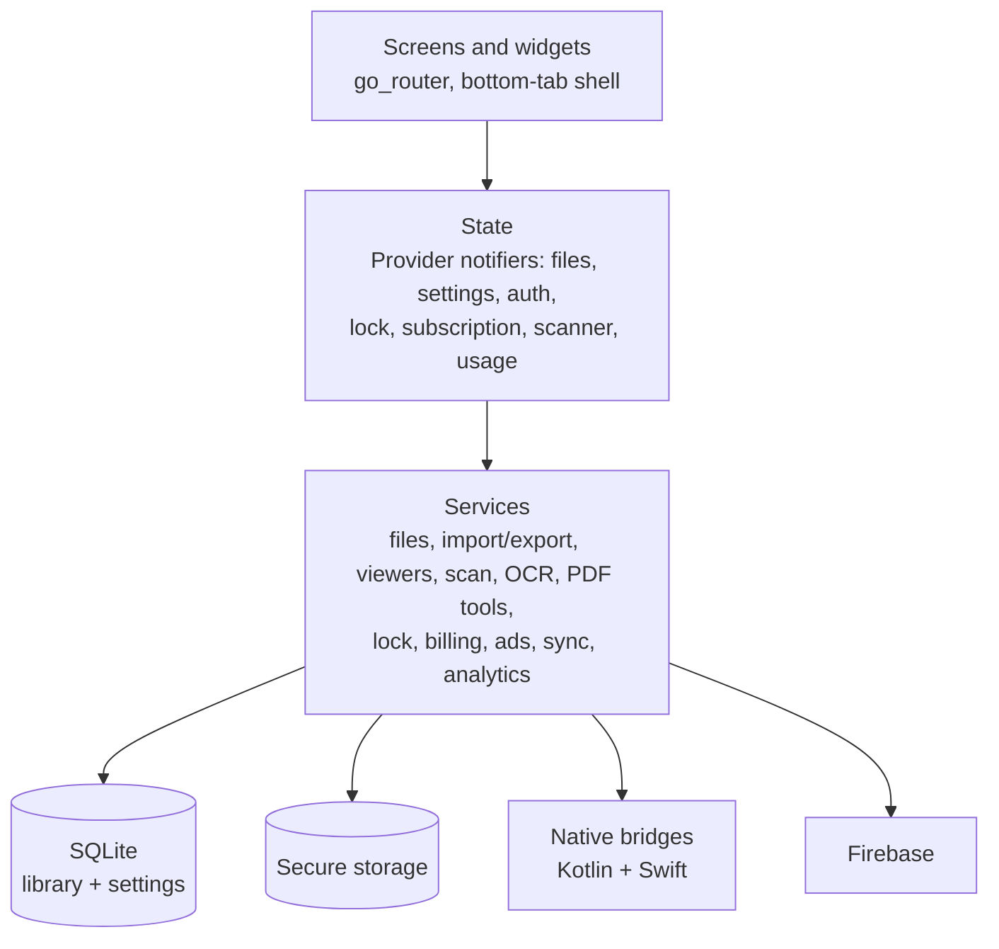
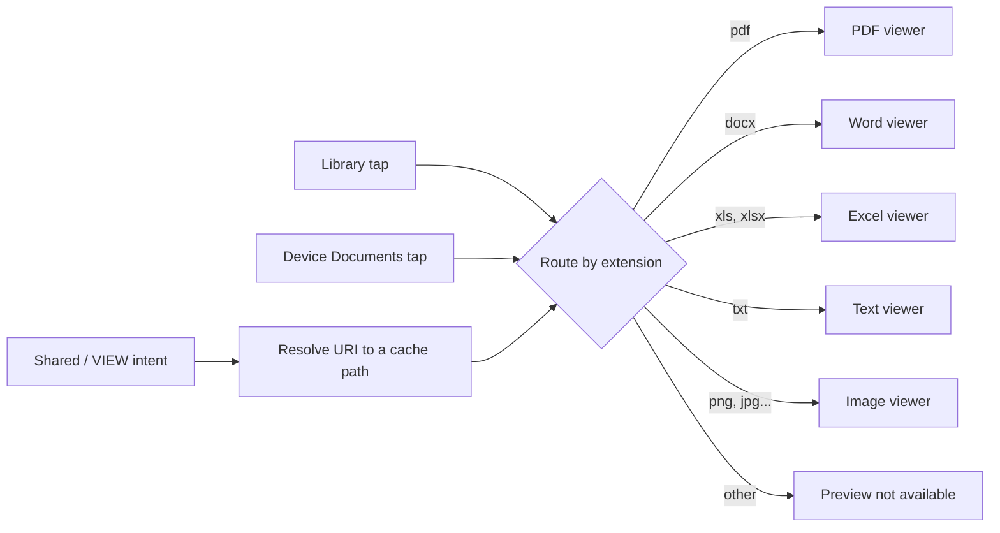
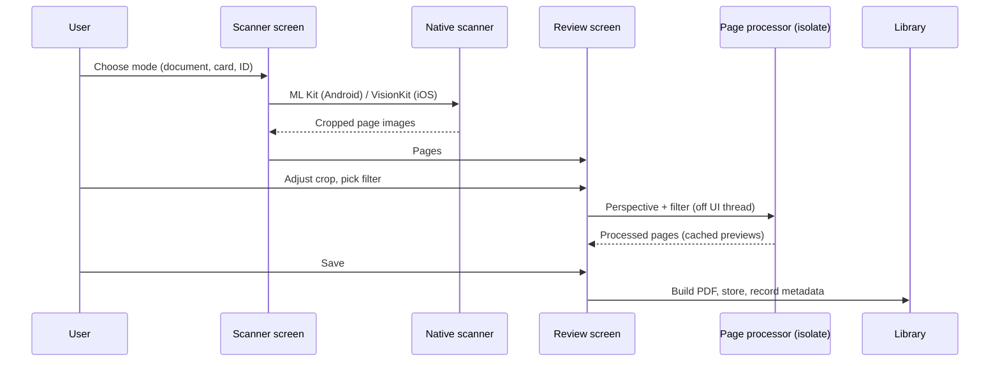
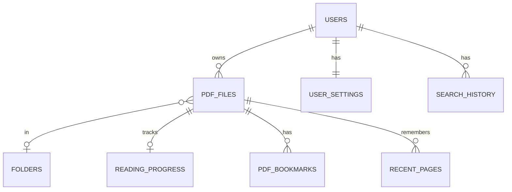
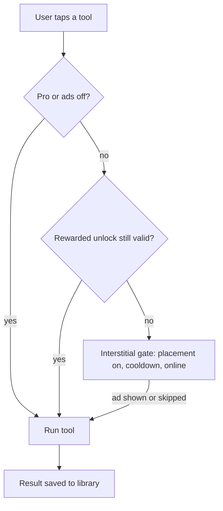

# Architecture

All diagrams are original and conceptual. They describe responsibilities, not production class or file names.

## 1. Layers

- **State** is held in `provider` notifiers. Screens read from them and call services; services own the I/O.
- **Services** are the only code that touches SQLite, the file system, ML Kit, billing, ads or Firebase.
- **Native bridges** exist where Flutter plugins do not cover the need: listing shared-storage documents, printing, handling incoming file intents and, on iOS, the VisionKit scanner.

## 2. Opening a file

Incoming Android `VIEW` and `SEND` intents are consumed outside the router. Content URIs are resolved to a real filename through the storage framework's display name, because the path segment of a document URI is often opaque. A cold-start intent is read once at launch; later intents arrive through a callback.

## 3. Scan to PDF

## 4. Library storage

Tables beyond these store notifications, usage and import/export statistics, subscription state and credits. The schema is versioned (currently version 9) with migrations. Guest users get local rows the same way signed-in users do.

## 5. Ads and unlocks

Placement modes live in a remote document; a placement is enabled only by an explicit non-zero value, and everything is off until a read succeeds. The tool action starts as soon as the ad plays or is skipped; a "processing" popup stays up if the work outlasts the ad.

## 6. Sync

Settings and profile data merge between Firestore and local SQLite on sign-in and restore, with a live listener for changes from another device, and locally saved changes are flushed when connectivity returns.
